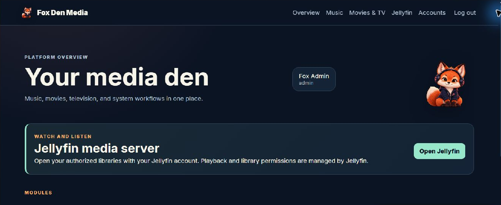

# Fox Den Media

**Fox Den Media** is a modular, self-hosted platform that brings a Portal, Music management, Movies/TV requests and imports, and optional Jellyfin and download services behind one Nginx ingress. Each application retains its own processes and state. The repository preserves the original Music lineage and imported unique Media history.

Current source milestone: **0.9.7**. This is a security-hardened **copied-state rehearsal candidate**, **not a production-validated release**. Passing CI alone does not authorize a NAS migration, torrent cutover, or a 1.0.0 release. See [production readiness](docs/production-readiness.md).



## Features and architecture

| Component | Purpose | Availability |
| --- | --- | --- |
| Nginx + Portal | Local login, optional Authentik OIDC, admin-only module access, activity | Core |
| Music web + worker | Requests, intake, metadata, review/import, library management, optional Jellyfin refresh | `music` |
| Movies/TV | Requests, reviewed torrent imports, checksum/overwrite protections | `media` |
| Firefox | Contained browser behind Portal authorization | `browser` (requires Music) |
| qBittorrent + Gluetun | VPN-isolated managed downloader | `managed` |
| Jellyfin | Official server, native client login, read-only media | `jellyfin` |
| Watch & Listen | User-scoped Jellyfin browsing and playback **handoff** | Configured Jellyfin |

```text
User / HTTPS proxy -> Nginx ingress :8080 -> Portal :8020
                                         -> Music web :8000 -> Music worker
                                         -> Movies/TV :8010 -> reviewed media imports
                                         -> Firefox HTTP :5800 (optional)
                                         -> Portal WebSocket relay -> Firefox noVNC
                       Jellyfin host   -> Jellyfin :8096 (optional; native login)
Movies/TV -> qBittorrent API -> Gluetun namespace -> WireGuard (managed only)
```

The host ingress bind defaults to `127.0.0.1:8080`; managed Gluetun also offers a separately loopback-bound qBittorrent Web UI port. Module backends are not host-published. Acquisition and contained-browser routes require a Portal administrator; Jellyfin maintains independent users and roles. See [architecture](docs/architecture.md) and [permissions](docs/permissions.md).

Fox Den does **not** currently deliver embedded Jellyfin playback, Android/Wear OS apps, automated torrent deletion, or a production-approved migration. See the [roadmap](docs/ROADMAP_TO_3.0.0.md).

Active browser WebSocket connections are reauthorized against the live Portal session and stored administrator role every 15 seconds, with a one-hour maximum lifetime. Authentik changes between verified logins are **not immediately detected** without a trusted upstream event or refresh. See [RA-06 security review](docs/browser-session-security-1.0.md). Exact pinned-Firefox/noVNC manual acceptance remains pending in a new disposable NAS rehearsal.

## Deployment modes

| Mode | Compose profiles | Main services |
| --- | --- | --- |
| `music` | `music` | Core, Music web and worker |
| `media` | `media` | Core, Movies/TV; external qBittorrent |
| `jellyfin` | `jellyfin` | Core, official Jellyfin |
| `full-external` | `music`, `media` | Both modules; external downloader/Jellyfin as configured |
| `full-managed` | `music`, `media`, `managed` | Both modules, qBittorrent, Gluetun |

Add `--browser` only to a mode with Music; `--jellyfin` adds the server; `--jellyfin-hwaccel` also loads a reviewed `/dev/dri` override. Merely specifying variables does not enable profiles. With `scripts/foxden.py`, the `--browser` flag also enables Music's server-browser link; omitting it clears the link. For direct Compose, explicitly set `REMOTE_BROWSER_URL=/server-browser/` with `--profile browser`; Music suppresses the link if Firefox is unreachable. See [browser availability](docs/browser-availability-0.9.5.md).

## Requirements

- Linux or compatible NAS with Docker Engine and **Docker Compose v2** (`docker compose`), available storage and Docker access.
- Python 3 (CI uses 3.12) and the Portal package's declared dependencies for Ed25519 key generation.
- Distinct persistent directories, planned numeric UIDs/GIDs, and an independently tested backup/restore process.
- For Internet access: an HTTPS reverse proxy, matching public origin and secure cookies.
- For `full-managed`: `/dev/net/tun`, an authorized WireGuard provider, and **real fail-closed VPN testing** before any production downloader use.

There is no universally validated minimum NAS RAM/disk requirement; resource defaults are in [Compose](deploy/compose.yaml).

## Quick start: isolated Music example

```bash
git clone https://github.com/ItsFoxxin/Fox_Den_Media.git
cd Fox_Den_Media
git switch dev  # integration branch; use a reviewed release ref when available
cp deploy/examples/music.env.example .env
```

Edit `.env` to set **new test-only absolute directories**, IDs, `FOXDEN_PUBLIC_ORIGIN` and a real `MUSICBRAINZ_CONTACT`. For this local HTTP example, keep `FOXDEN_BIND_IP=127.0.0.1` and `PORTAL_COOKIE_SECURE=false`. In a Python virtual environment:

```bash
python -m pip install -e apps/portal
python scripts/foxden.py init --env .env --create-paths
python scripts/foxden.py validate music --env .env
python scripts/foxden.py deploy music --env .env  # dry run; no containers started
python scripts/foxden.py deploy music --env .env --execute
docker compose --env-file .env -f deploy/compose.yaml --profile music ps
```

Initialization creates private random secrets without overwriting them and empty placeholders for optional provider secrets. Confirm UID/GID access and fill required integration credentials before use. `validate` renders a private Nginx runtime file as well as checking the selected mode. `deploy` prints a command unless `--execute` is present. **Never expose this local HTTP example to the Internet.**

See [deployment](docs/deployment.md) for preflight, image build/pull, first login, logs, updates, backups and rollback.

## Configuration, security and persistence

The interfaces of record are [deployment controller](scripts/foxden.py), [Compose](deploy/compose.yaml), and [mode examples](deploy/examples/). Use an untracked environment file; keep credentials in `FOXDEN_SECRETS_DIR`, not in Compose or Git. Persistent state includes Portal, Music, Movies/TV, and optional browser/Jellyfin/qBittorrent/Gluetun directories. Read [configuration](docs/configuration.md), [security](docs/security.md), and [torrent/VPN isolation](docs/torrent-vpn.md).

Portal supports local, OIDC and hybrid authentication. It signs short-lived internal module identities; Jellyfin still authenticates native clients separately. Watch & Listen uses each user's own linked Jellyfin account and hands playback to Jellyfin Web. See [Jellyfin](docs/jellyfin.md) and [identity](docs/authentik-jellyfin-auth.md).

**Never share a live writable database/config directory between old and new deployments.** A preexisting NAS with Jellyfin, Gluetun and qBittorrent needs separate test ports, copied state, a verified backup and a reviewed cutover. See [Ugreen NAS](docs/ugreen-nas.md) and [side-by-side migration](docs/side-by-side-migration.md).

## Development, testing and releases

- `main` is protected, default and stable; `dev` is protected integration. Use reviewable feature/docs/security PRs into `dev`; promote reviewed `dev` to `main` separately.
- CI covers tests, Compose modes, container smoke, real audio, migration fixtures, dependency auditing, Bandit, secret scanning and CodeQL. Its aggregate check is **Monorepo strict gate**.\n- [Versioning and bug tracking](docs/versioning-and-bug-tracking.md) uses one-step major/minor/patch releases; each future patch must fix one tracked GitHub bug issue, with a dedicated release increment, regression test and PR.
- `VERSION` and `CHANGELOG.md` record the current development milestone, **not** production acceptance or proof of a published GitHub release. CI never deploys the NAS.

See [CI/development](docs/ci.md), [validation evidence](docs/validation.md), and the [1.0.0 checklist](docs/release-1.0-checklist.md).

## Documentation

Start with the [documentation index](docs/README.md), then [deployment](docs/deployment.md), [configuration](docs/configuration.md), [NAS](docs/ugreen-nas.md), [migration](docs/side-by-side-migration.md), [architecture](docs/architecture.md), [security](docs/security.md), or [troubleshooting](docs/troubleshooting.md). See [readiness blockers](docs/production-readiness.md) and [roadmap](docs/ROADMAP_TO_3.0.0.md).

🦊 One Den. One Platform. One Repository.
