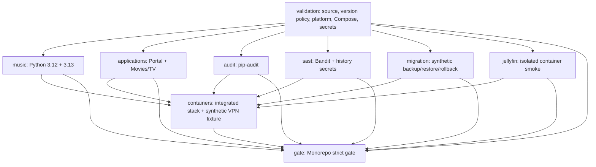
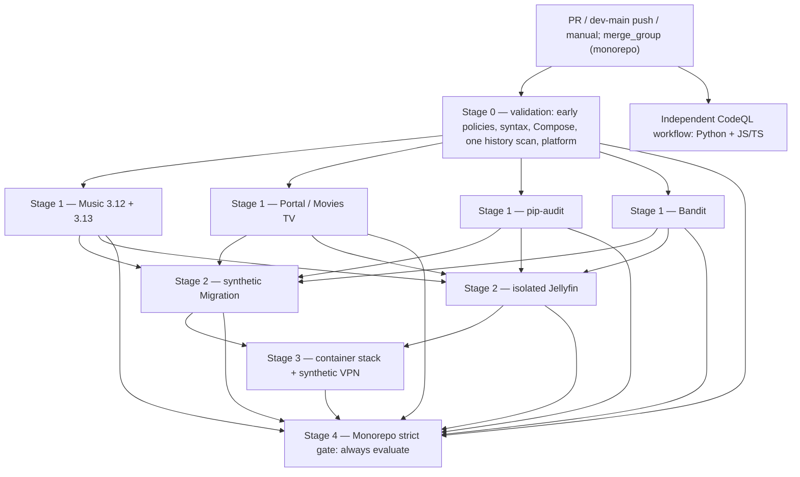

# Fox Den Media CI — execution architecture and efficiency design

> **Design-only PR #30.** This document proposes future changes; it does not edit
> workflow YAML, branch rulesets, release automation, credentials, the NAS, or
> deployments. PR #29 / Dependabot is a separate workstream and is untouched.
> No merge or deployment is authorized by this design.
>
> Audited on 2026-11-06 Eastern (2026-11-07 UTC), using
> [monorepo.yml](../.github/workflows/monorepo.yml),
> [codeql.yml](../.github/workflows/codeql.yml), live workflow executions,
> and active repository rulesets. Workflow code reviewed from `dev`;
> proposed documentation lives only on `docs/ci-execution-design`.

## Implementation status and verified evidence (Phase 2, November 7, 2026)

This section tracks adoption of the architecture without rewriting the
historical **pre-Phase-2** audit below. The "Current execution graph"
and findings in sections 3–4 describe the original baseline examined
in PR #30, **not** the updated workflow once Phase 2 merges.

- **PR #30 — merged:** the accepted architecture and staged approach.
- **PR #31 — merged:** Phase 1 preserved Validation and its dependent
  checks, added checksum-pinned actionlint, reordered early policy
  validation and eliminated the duplicate secret-history scan.
- **PR #33 — proposed, not merged:** Phase 2 changes **only**
  `migration.needs` and `jellyfin.needs` from `validation` to
  `[music, applications, audit, sast]`. Validation remains the upstream
  prerequisite of all four core jobs. These core jobs run concurrently;
  both Music Python matrix versions are required. Migration and Jellyfin
  begin together only when **every** core job group passes. Integration
  and the all-results `Monorepo strict gate` retain their previous
  `needs` and strict failure semantics. CodeQL remains separate.
- **Phase 3, not started:** trigger deduplication; branch and PR trigger
  configuration has intentionally not changed in PR #33.

The proposed graph in section 5 is **exactly** the Phase 2 graph. No
additional job, skipped-test exception, mandatory reviewer, altered
CodeQL requirement, production deployment or release stage is added.

### Live verification and benchmarking

First successful [Phase 2 run 42363676078](https://github.com/ItsFoxxin/Fox_Den_Media/actions/runs/42363676078)
finished with all ten monorepo job instances successful (two Music
versions, six other test/security job instances, integration and gate).
The longest core job (Music 3.12) completed at 10:23:38 UTC; Jellyfin
started at 10:23:40 UTC and Migration at 10:23:41 UTC, overlapping one
another. Only after they succeeded did integration start at 10:24:17 UTC.

| Sample | Monorepo wall-clock | Sum of job execution durations |
| --- | ---: | ---: |
| Pre-Phase-1 design [run 42328872182](https://github.com/ItsFoxxin/Fox_Den_Media/actions/runs/42328872182) | 191 s | 360 job-seconds |
| Phase 1 [run 42361440923](https://github.com/ItsFoxxin/Fox_Den_Media/actions/runs/42361440923) | 185 s | 360 job-seconds |
| Phase 1 [run 42362886896](https://github.com/ItsFoxxin/Fox_Den_Media/actions/runs/42362886896) | 202 s | 374 job-seconds |
| **Phase 2, first green run** [42363676078](https://github.com/ItsFoxxin/Fox_Den_Media/actions/runs/42363676078) | **225 s** | **343 job-seconds** |

Green-run latency increased relative to the two sampled Phase 1 runs:
that is the expected cost of placing isolated heavy work behind all
core checks. Reducing actual total runner work on *failed-core* PRs,
not accelerating every green PR, is the primary reason for these
dependencies. Job seconds are **not GitHub billing totals**; cache,
runner, Docker image and network variability mean these runs cannot
establish a reliable cost trend on their own.

In a **disposable unmerged** [failure-probe PR #34](https://github.com/ItsFoxxin/Fox_Den_Media/pull/34),
a test-only deliberate Bandit job failure in
[run 42363769908](https://github.com/ItsFoxxin/Fox_Den_Media/actions/runs/42363769908)
left Music (both Python versions), apps, and dependency audit successful;
**Migration, Jellyfin and integration all skipped**, while the
`Monorepo strict gate` **failed**. Independent CodeQL analysis
[passed](https://github.com/ItsFoxxin/Fox_Den_Media/actions/runs/42363769983).
The disposable probe must never merge. `if: always()` still evaluates
the gate; any skipped/cancelled/failed result is unequal to `success`.
No intentional failure was pushed to `dev`.

**Trade-off to revisit after benchmark collection:** the separate
Migration suite is short (~9 seconds). Keeping it parallel with core
checks would improve failing-PR diagnostics and save a little green-run
critical path at the cost of executing it even when core fails; the
approved all-core gate instead prioritizes lower unnecessary execution
on invalid PRs. Do not quietly change that policy outside another
reviewed implementation PR.

---

## 1. Decision summary

**Recommended:** maintain one short existing `validation` prerequisite; run
independent Music, application, dependency-audit, and static-security work
concurrently; make synthetic Migration and Jellyfin smoke wait for **all**
required core checks; retain integration after both; retain an unconditional,
failing aggregate `Monorepo strict gate`. Keep CodeQL independent.

**Do not split Validation into two runners yet.** A measured successful
Validation job took only 19 seconds, and the source/platform tests inside it
took approximately two seconds. First reorder its internal steps so release/
PR policy, cheap syntax and Compose checks execute as early as their tool
prerequisites allow; add workflow linting with a pinned tool. Splitting off a
new preflight job could add runner startup and serial latency without
meaningful benefit. Reconsider only after a before/after measurement.

**Retain the entire current test and scanner coverage.** Eliminate only
verified duplication (history scan, and overlapping migration unit tests)
with evidence that each test still runs once. Preserve the established
required status-check names. Defer all YAML changes to small implementation
PRs.

**Main trade-off:** moving Jellyfin (31 seconds in the sample) behind the
slowest core check can add about 30 seconds to a passing PR. On a core
failure, however, Migration and Jellyfin will never start, and integration
will remain skipped. The effect must be benchmarked across multiple runs,
not assumed.

## 2. GitHub Actions vocabulary in this repository

| Term | Actual example | Scheduling behavior |
| --- | --- | --- |
| Workflow | `monorepo.yml`, `codeql.yml` | Triggered independently by PR, push, or a manual event |
| Job | `validation`, `music`, `sast`, `containers`, `gate` | Separate runner execution; `needs` controls its prerequisites |
| Step | `python -m pytest`, `pip-audit`, `docker compose config` | Ordered inside its own job; a failed step normally stops later normal steps |
| Runner | `ubuntu-24.04` | A new, isolated ephemeral machine for each job or matrix expansion |
| Matrix | `music` on Python 3.12 and 3.13 | Two job instances; both matter for compatibility |
| `needs` | `music: needs: validation` | A prerequisite that must succeed by default or the dependent job skips |
| `if: always()` | `gate` | Evaluates even when its prerequisites fail or skip; must inspect their results explicitly |
| `strategy.fail-fast: false` | Music matrix | Both Python versions continue for diagnostic coverage when one fails |
| Workflow concurrency | `cancel-in-progress: true` | Replaces superseded runs **within the same concurrency group**, not all push/PR duplicates |

`needs` is a dependency graph, **not** a command to serialize every job.
Unrelated jobs can start in parallel. `containers` already waits for all
six current core/heavy job groups. Also distinguish a job that is
**skipped** from a successful job: a skipped dependent job does **not**
automatically make a required status check fail in branch protection.
The explicit aggregate gate is therefore essential.

## 3. Current execution and checks (verified)

### Current graph

`codeql.yml` is independent, with two parallel language instances:
`CodeQL (python)` and `CodeQL (javascript-typescript)`. It is not
a `needs` prerequisite of `Monorepo strict gate`; repository rulesets
enforce it separately. It uses `security-extended` queries.

### What is tested and why

| Current job | Important checks | Protects against | Current dependency |
| --- | --- | --- | --- |
| Validation and deployment modes | Python compile, JS syntax, release/version and single-bug issue policy, full-history secret scan, platform/integration-config tests, seven Compose configurations | Unparseable code, invalid version/issue workflow, invalid deployment definitions, common platform regressions, leaked secrets | None |
| Music regressions and real audio (3.12, 3.13) | Music backend suite and CI gates, real-media/FFmpeg test tooling, coverage minimum 78%, dependency consistency | Search/acquisition/audio regressions and interpreter incompatibility | Validation |
| Portal and Movies TV | Media, portal and non-platform root tests; FFmpeg support | Application regressions and broken portal/media behavior | Validation |
| Dependency vulnerability audits | Three `pip-audit --strict` scans and JSON artifacts | Known vulnerable dependencies and audit errors | Validation |
| Static analysis and secret scan | Bandit medium-or-higher severity/confidence and full-history secret scan | Source-level security patterns and checked-in secrets | Validation |
| Migration backup restore and rollback | Migration unit/security tests; synthetic archive verify, restore and rollback; 30-day artifacts | Broken migration/backup tooling | Validation |
| Optional Jellyfin container | Isolated Jellyfin smoke | Broken optional Jellyfin container startup/integration | Validation |
| Consolidated container integration | Starts temporary stack, HTTP/application smokes, synthetic VPN fail-closed fixture, unconditional cleanup | Cross-container failures and fail-open synthetic VPN behavior | All six dependent groups |
| Monorepo strict gate | Assert all direct `needs` results equal `success` | Prevents downstream skips from appearing acceptable for merge | All eight preceding job IDs; `if: always()` |
| CodeQL (separate workflow) | Python and JavaScript/TypeScript security queries | Deeper code-scanning issues | No monorepo prerequisite |

**Ephemeral/synthetic is not production acceptance:** the migration fixture
does not validate real NAS data, qBittorrent state, VPN egress, Authentik,
backups, hardware transcode or a live cutover. Those remain separate
manual acceptance activities and are not deploy/release steps in GitHub CI.

### Observed live runtimes

Source: successful
[PR #30 monorepo run 42328872182](https://github.com/ItsFoxxin/Fox_Den_Media/actions/runs/42328872182),
started 2026-11-07 02:21:52 UTC. Separate
[CodeQL run 42328872233](https://github.com/ItsFoxxin/Fox_Den_Media/actions/runs/42328872233).

| Monorepo job instance | Observed job duration |
| --- | ---: |
| Validation | 19 s |
| Music 3.12 | 40 s |
| Music 3.13 | 54 s |
| Portal / Movies TV | 45 s |
| pip-audit | 40 s |
| SAST | 12 s |
| Migration | 12 s |
| Jellyfin | 31 s |
| Consolidated integration | 103 s |
| Strict gate | 4 s |

End-to-end monorepo workflow: **approximately 3 min 11 sec**; CodeQL
workflow: **approximately 1 min 05 sec**. Ten monorepo job instances
(including both Music matrix versions) ran in parallel stages, plus two
CodeQL language instances. These are observed execution intervals, **not**
billed runner-minute totals. One run is not a performance distribution.

**Existing failure propagation works for Validation failures:**
[run 42324314012](https://github.com/ItsFoxxin/Fox_Den_Media/actions/runs/42324314012)
failed its PR semantic-version policy. The six dependent job groups
and consolidated integration skipped; `Monorepo strict gate` actually
failed. We must retain this exact safety property.

### Active repository rulesets — verified, not assumed

- [`dev` ruleset 26664707](https://github.com/ItsFoxxin/Fox_Den_Media/rules/26664707):
  `Monorepo strict gate`, `CodeQL (python)`,
  `CodeQL (javascript-typescript)` are required.
- [`main` ruleset 26667058](https://github.com/ItsFoxxin/Fox_Den_Media/rules/26667058):
  the same three checks **plus** the separate
  `CodeQL` check from GitHub's code-scanning app are required.
- Both rulesets: `required_approving_review_count: 0`,
  `require_last_push_approval: false`, no required reviewers,
  **review-thread resolution required**, up-to-date required checks
  (`strict_required_status_checks_policy: true`), no bypass actors.
  The extra approval for unattributed Copilot PRs is only relevant when
  a non-zero approval count is otherwise required. No independent
  human reviewer is currently mandated.
- Do **not** rename the above checks, weaken the rulesets, remove
  thread resolution or introduce approval/merge/release automation.

A successful CodeQL workflow is not by itself proof of **zero** code
scanning alerts. Treat the CodeQL security finding lifecycle separately;
preserve the extra `main` app check. Do not hide findings or quietly
turn an existing blocking check into a nonblocking one.

## 4. Confirmed waste, and what to do about it

### A. Full-history secret scanning happens twice

`scripts/scan_history_secrets.py` executes in both `validation` and
`sast`. Each job also requests a full-depth Git checkout.

- **Change:** Keep the full-history scan once in early Validation, where
  it already runs. Remove only the duplicate call from SAST, allowing
  SAST's checkout to become shallow if no other full-history consumer
  is found. Preserve Bandit and its report artifact.
- **Benefit:** One authoritative early secret policy, fewer full-history
  checkouts and less work; current measured scan steps were very short,
  so do **not** claim large time savings.
- **Trade-off:** History-scanner output moves to Validation instead of
  appearing in SAST. Keep diagnostic logging and artifact behavior clear.
  Revisit future introduction of a separate dedicated secret-check job
  only with benchmark evidence.

### B. Migration unit tests also overlap

Validation runs `pytest tests/platform`, which includes
`tests/platform/test_migration.py`; Migration runs that file again.

- **Change:** In a later tightly scoped PR, explicitly assign migration
  unit/security tests to the Migration job and remove just that overlap
  from the broad Validation test selection, **after** confirming exact
  test collection and coverage.
- **Benefit:** No duplicate test collection.
- **Trade-off:** Migration-specific failures appear later in the graph.
  The measured broad source/platform step was only about two seconds,
  so optimizing this is **lower priority** than trigger duplication or
  graph dependencies. Keep the tests duplicated if the new boundary
  reduces diagnostic or security value.

### C. Migration/Jellyfin are launched too soon

Both currently need only Validation, even when Music, Portal,
`pip-audit`, or Bandit fails.

- **Change:** Give both `migration` and `jellyfin` direct prerequisites
  `[music, applications, audit, sast]`, leaving existing Validation
  gating in the dependency chain. Keep them parallel with each other.
- **Benefit:** On failed core checks, avoid approximately 12 + 31
  seconds of observed Migration/Jellyfin job execution; integration
  already correctly skips if a prerequisite fails.
- **Trade-off:** Passing PRs can take about 30 seconds longer, because
  Jellyfin no longer overlaps the slower core tests. This is a trade
  for fewer wasted runner seconds and clearer failure stages, **not**
  an unqualified improvement in green-run latency.

### D. Some pushes trigger duplicate workflows

The two workflows' `push` triggers include `dev`, `main`,
`feature/**`, and `security/**`. PR events can launch the same
workflow family against the same source commit.

**This has happened:** source commit `8cdef0289a2443bdd19abb782e4871e0f16773da`
from `security/private-music-staging-permissions` produced both push
and PR runs for the monorepo and CodeQL workflows on Nov 5/6 UTC.
Likewise `feature/jellyfin-midnight-integration` commit
`479ab2776cabd5869c726230993fee3757ed30c3` did so.
Concurrency keys distinguish a PR number from a push ref and therefore
do not automatically merge or deduplicate those executions.

- **Change, in its own later PR:** Restrict push to `dev`/`main`,
  keep PRs targeting `dev`/`main`, keep `workflow_dispatch`.
  Preserve monorepo's existing `merge_group` event. Note that
  `pull_request.branches` filters **target/base** branches, not source
  branches. Do not assume `feature/**` there is needed for feature
  source branches.
- **Benefit:** One ordinary PR workflow per open PR update instead
  of a duplicate push/PR pair on matching branch names.
- **Trade-off:** New feature/security branches without a PR no longer
  automatically receive push validation. Open a draft PR early or
  manually dispatch a run; verify no protected integration use case
  relies on branch-only validation before implementation.
- **Further:** CodeQL currently does **not** declare `merge_group`.
  If the repository later enables a merge queue, explicitly add and
  verify CodeQL merge-group support for required checks. Do not
  change this without a queue requirement.

### E. Preflight ordering and runner setup

Validation installs Python, Node, pytest, PyYAML and cryptography,
then executes source/platform checks **before** the PR version policy.
The user-visible failure in run 42324314012 happened at the version
step after previous tests had run.

- **Change:** After the minimum necessary setup, validate the PR
  version/linked-issue policy, cheap source syntax, release rules,
  Compose configuration, history scan and workflow `actionlint` before
  larger suites. The `actionlint` binary/action must be version-pinned
  and verified; keep token permissions minimal.
- **Benefit:** Earlier failure within the **existing** Validation job,
  preserving its current job/check names and runner count.
- **Trade-off:** Carefully stage environment setup; some early checks
  need Python packages, Git history, Docker Compose or the GitHub CLI.
  A workflow YAML file that GitHub cannot parse may not schedule
  `actionlint` inside itself; use local linting and required-check
  presence as additional safeguards.

### F. Repeated setup is not necessarily duplicate testing

Each Music matrix job and the application suite separately installs
pinned FFmpeg tooling, and many jobs repeat checkout/setup-python.
That is normal isolation across runners. Avoid introducing a shared
mutable runner or complicated cross-job cache only to eliminate
short setup time. Reassess with step-level timing if it becomes a
measured bottleneck. Never replace an authenticated/pinned binary
with an unverified download for speed.

## 5. Proposed dependency architecture

The arrows mean **hard prerequisites**. Both heavy jobs need all core
checks; both heavy jobs may run in parallel once core is green.
Integration starts only when their prerequisites succeeded. The gate
runs even if a dependency failed or skipped, but must itself return
**failure** unless all of its required `needs` succeeded.
The CodeQL branch-status requirements are independent of that gate.

### Stage-by-stage decisions

| Stage | Start condition | What can run concurrently | What a failure blocks | Trade-off |
| --- | --- | --- | --- | --- |
| 0 — Validation | Trigger eligible | CodeQL independently | All dependent monorepo work | Keep one runner, reorder cheap checks |
| 1 — Core | Validation succeeded | Two Music versions, apps, audit, SAST | Migration, Jellyfin, integration | Four groups / five job instances intentionally parallel |
| 2 — Heavy | **Every** core group succeeded | Migration and Jellyfin | Integration | Slower green critical path, less waste on failures |
| 3 — Integration | Both heavy jobs succeeded | No additional mandatory stack job | Final pass | At 103 s it is the main remaining bottleneck |
| 4 — Strict gate | Required monorepo jobs have resolved | Independent CodeQL may already have finished | PR merge when gate fails | Stable single aggregate required context |

**Failure-handling rules:**

1. Do not use `continue-on-error` for any required step or job.
2. Do not hide core failures by marking dependent heavyweight jobs
   successful on skip. Their state should remain `skipped`; the gate
   must fail by inspecting `needs.*.result`.
3. Retain `fail-fast: false` on the Music matrix for diagnostic
   coverage: both interpreters are tested, even when one fails.
4. Preserve `if: always()` for cleanup of ephemeral integration
   resources, and do not allow cleanup failure handling to mask the
   original integration-test failure.
5. Retain independently required CodeQL checks even when Validation
   fails, so CodeQL findings are visible and cannot silently disappear
   behind a monorepo prerequisite.
6. Cancellation of superseded runs is allowed; **no cancelled run
   can be considered a successful required validation of a new SHA**.

### Estimated passing-run latency

In sample run 42328872182, the longest core instance finished
approximately 54 seconds after starting, while Jellyfin finished
earlier after 31 seconds. Gating Jellyfin behind core would shift
its execution later and can delay `containers` by approximately
31 seconds; Migration (12 seconds) would overlap Jellyfin. Expect
a successful run near 3.5–4 minutes under similar scheduling,
**not** a claimed exact forecast. On a core failure, the two stage-2
jobs should be skipped and save their observed combined ~43 seconds
of runner execution. Measure before drawing conclusions about
billing, queues, cache misses, variability or overall savings.

## 6. Required status preservation

Until a separate reviewed ruleset change, these exact contexts stay
required:

| Target | Required checks |
| --- | --- |
| `dev` | `Monorepo strict gate`, `CodeQL (python)`, `CodeQL (javascript-typescript)` |
| `main` | All `dev` checks plus `CodeQL` (GitHub code-scanning app) |

Keep both rulesets at **zero required approving reviews**, no required
last-push approval or code-owner approval, and retain thread-resolution
and strict up-to-date checks. No automatic merge, release publishing,
GHCR push, production deployment or NAS changes. Workflow code and
documentation are insufficient to enforce scan alert policy: explicitly
monitor security alerts and repository security settings separately.

## 7. Failure-propagation test plan (implementation PRs only)

Use temporary disposable test branches/PRs against `dev`; never
introduce failure fixtures into `dev`, `main`, the NAS or PR #30.
Make each failure intentional and reversible; inspect the graph,
individual job conclusions and exact required check contexts. Remove
test-only failures before accepting the implementation PR.

| Injected condition | Must run | Must skip | Must fail / block |
| --- | --- | --- | --- |
| Early release/version/Compose policy failure | Validation; independent CodeQL if scheduled | Music, apps, audit, SAST, Migration, Jellyfin, integration | Validation, aggregate gate, merge eligibility |
| Music 3.12 or 3.13 regression | Validation; both Music matrix versions; independent apps, audit, SAST, CodeQL | Migration, Jellyfin, integration | Music aggregate, strict gate, merge eligibility |
| Audit or SAST failure (use test-only controlled exit, not a vulnerable dependency or a real secret) | Validation and other independent core checks; CodeQL | Migration, Jellyfin, integration | Failed core job, strict gate, merge eligibility |
| Synthetic Migration failure | Core checks, Migration, independent Jellyfin, CodeQL | Integration | Migration, strict gate, merge eligibility |
| Jellyfin smoke failure | Core checks, Migration, Jellyfin, CodeQL | Integration | Jellyfin, strict gate, merge eligibility |
| All checks green | Every mandatory job and CodeQL language scan | None of required jobs | No failed mandatory status; solo maintainer may merge after thread resolution/up-to-date checks |
| CodeQL fails while monorepo succeeds | Monorepo and CodeQL remain independently visible | No unrelated monorepo jobs | Ruleset must block merge on failed CodeQL context |
| Superseded PR push | Newest run for the PR | Old run may cancel | Only the newest relevant SHA is acceptable for merge |

Also verify that failed integration tests still execute cleanup;
reports use `if: always()` and retain current artifact names/retention;
both Music versions and all Compose profiles run on passing PRs.
The strict gate must inspect the entire required `needs` result set,
not merely the last `containers` result. Beware of adding an
optional/conditional job directly to that set: an intentional skip
would fail this strict design unless explicitly and safely accounted for.

**Separate syntax caveat:** a workflow rejected by GitHub's YAML
validator may never schedule its jobs; therefore an inside-workflow
`actionlint` step is not a full proof against malformed workflow
syntax. Include local validation and test the resulting required
check state, which may remain pending, rather than pretending the
aggregate job always runs.

## 8. Small implementation PR sequence (none applied here)

1. **Workflow hygiene:** add pinned `actionlint`, move cheap policy
   validation earlier within the existing Validation job, run the
   full-history secret scanner once, and shallow SAST checkout if safe.
   Preserve all check/job names and scan/report coverage.
2. **Dependency graph:** update only the `needs` of Migration and
   Jellyfin; preserve `containers` and `gate`; run deliberate
   failure-propagation tests on disposable PRs and collect new timing.
   Check whether retaining Migration's duplicated unit suite is
   worthwhile before changing its placement.
3. **Trigger efficiency:** separately remove redundant
   `feature/**`/`security/**` push triggers after confirming early
   draft PRs and `workflow_dispatch` cover pre-PR needs. Preserve
   `dev`/`main` pushes and required PR events. Do not touch
   Dependabot PR #29.
4. **Benchmark and polish:** compare sample distributions and
   optional future optimizations (cache trust boundaries,
   concurrent scans, integration images, per-step timing) in a
   subsequent dedicated PR, changing only one bottleneck at a time.

There is **no** proposed automated release or NAS deployment stage.
Future release-candidate acceptance remains a separately authorized
manual process.

## 9. Benchmark and acceptance checklist

For the current baseline and each implementation increment, record
at least five representative **successful** runs plus selected failing
runs: trigger/event, head SHA, workflow wall time, each job's start/end,
runner execution duration sum, CodeQL outcomes, skipped jobs, and
required-status results. If GitHub billing data is available, capture
actual billed usage **separately**; summed wall times are not invoices.
Compare median and range as well as total wasted work on failed PRs.
Include a repeated push/PR same-SHA audit after the trigger change.

An implementation is acceptable only if:

- All existing suites, Python versions, vulnerability/security checks,
  synthetic migration/Jellyfin tests and integrated/VPN fixtures still
  execute successfully on eligible clean PRs.
- Cheap failures prevent unnecessary downstream work; independent
  diagnostic/security checks are not accidentally serialised.
- The aggregate gate fails on failure/skips and the active rulesets
  actually block the merge; status-check identities remain unchanged.
- Reports, pinned actions, minimum token permissions, cancellation,
  cleanup and current security controls are retained.
- Solo-maintainer merging after green automated checks and resolved
  threads remains possible, without a required independent review.
- No default-branch, PR #29, Dependabot, release, NAS or deployment
  configuration is changed as part of this design PR.

## References

- [Successful PR #30 monorepo run](https://github.com/ItsFoxxin/Fox_Den_Media/actions/runs/42328872182)
- [Successful PR #30 CodeQL run](https://github.com/ItsFoxxin/Fox_Den_Media/actions/runs/42328872233)
- [Version-policy failure and correctly failed strict gate](https://github.com/ItsFoxxin/Fox_Den_Media/actions/runs/42324314012)
- [GitHub: jobs and dependencies](https://docs.github.com/en/actions/how-tos/write-workflows/choose-what-workflows-do/use-jobs)
- [GitHub: troubleshooting required status checks](https://docs.github.com/en/pull-requests/how-tos/merge-and-close-pull-requests/troubleshooting-required-status-checks)
- [GitHub: workflow concurrency](https://docs.github.com/en/actions/how-tos/write-workflows/choose-when-workflows-run/control-workflow-concurrency)
- [GitHub: workflow trigger syntax](https://docs.github.com/en/actions/reference/workflows-and-actions/workflow-syntax)
