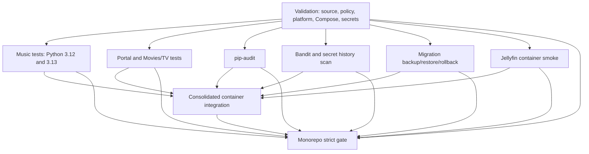
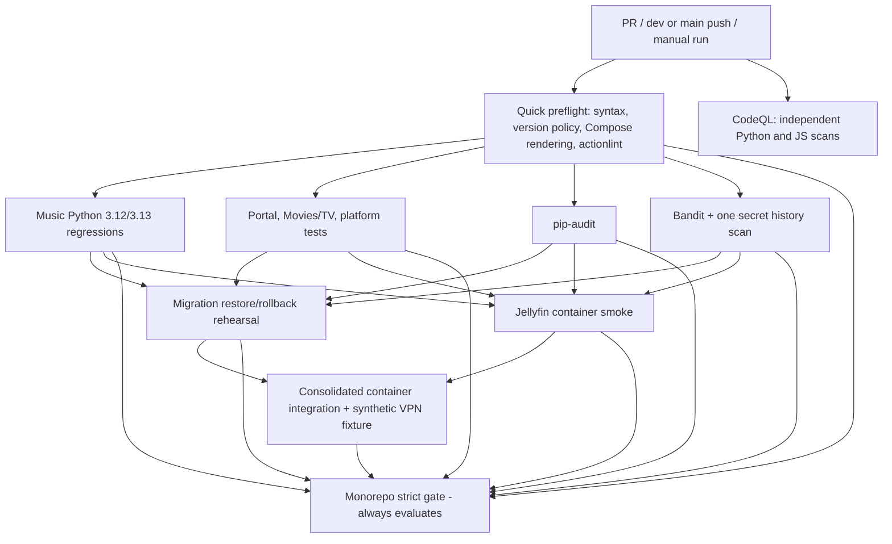

# Proposed Fox Den Media CI execution architecture

> **Design proposal only.** This branch changes documentation, not workflows,
> GitHub rulesets, NAS hosts, containers, releases or production deployments.
> Source reviewed: `.github/workflows/monorepo.yml` and `.github/workflows/codeql.yml` on `dev` (November 2026).

## Goals

1. **Fail early on cheap, deterministic mistakes** before spending runner minutes
   on full suites or Docker integration.
2. **Run independent checks in parallel** when they provide useful feedback;
   avoid serializing everything simply to force a tidy-looking graph.
3. **Do not start expensive jobs after a prerequisite has failed**.
4. Keep **CodeQL** independently visible and required; a scanner completing
   successfully is not equivalent to having zero findings.
5. Preserve the existing **Monorepo strict gate** and CodeQL required-check names
   until any ruleset change is explicitly coordinated.
6. Preserve solo-maintainer PR merges: **zero required human approvals**,
   green required checks, human-controlled merge, release and NAS deployment.
7. Keep real NAS/VPN, credentials, Authentik, hardware transcode, data migration,
   backups and rollback as **separate acceptance gates**; GitHub CI uses synthetic
   state and ephemeral runners only.

## Current execution graph (simplified)

CodeQL is a **separate workflow** with a Python and JavaScript/TypeScript
matrix. Its checks are enforced separately by the GitHub branch rulesets.

### Observations

- The **full-history secret scanner runs twice**: once in Validation and once
  in Static analysis. Remove duplication while preserving coverage and reports.
- Migration and Jellyfin **start immediately after Validation** even if Music,
  Portal/Movies, pip-audit or Bandit later fail. These expensive jobs can wait.
- `push` for `feature/**` and `security/**` plus PR triggers can produce
  separate runs for the same open PR update. Evaluate simplifying push triggers
  to `dev`/`main` while keeping PR, merge_group and manual events.
- Validation mixes quick structural checks and platform tests. Separate quick
  preflight from more expensive tests when doing so does not lose coverage.
- CodeQL has separate successful-run status versus actionable alerts. Review
  branch-required contexts, including the extra generic `CodeQL` on `main`,
  before changing names or scanner modes.
- Do **not** introduce job-level `continue-on-error` for required checks. A
  skipped required prerequisite is not an acceptable success.

## Proposed graph (conceptual target, not yet implemented)

The `needs` arrows are **hard prerequisites**: by default GitHub skips a
dependent job when a prerequisite fails. The aggregate gate uses `if: always()`
and verifies each required job's result is `success`, including when a job
was skipped or cancelled. CodeQL remains independent, so security results are
not hidden behind unrelated test failures; GitHub rulesets require its
separate statuses.

### Why this ordering?

| Stage | Work | Failure prevents | Reason |
| --- | --- | --- | --- |
| 0 — preflight | Parse/syntax, version/issue policy, Compose config, workflow lint | All medium/heavy monorepo jobs | Cheap mistakes should fail in minutes, before Docker starts |
| 1 — parallel core | Music matrix, apps/platform, pip-audit, SAST + single secret scan | Migration, Jellyfin, integration | Independent feedback, but no expensive follow-on if any required check fails |
| 2 — parallel heavy | Synthetic migration rehearsal and isolated Jellyfin smoke | Consolidated integration | Confirm prerequisites before whole-stack work |
| 3 — integration | Integrated ephemeral stack, app smoke, synthetic VPN fail-closed test | Release readiness | Expensive test of interactions after cheaper checks pass |
| 4 — reporting | Monorepo strict gate; CodeQL remains separately required | PR merge if unsuccessful | Stable, auditable check results, no review requirement |

**Trade-off:** A green run may have slightly longer critical-path latency if
we move migration/Jellyfin behind core checks. Failed PRs should consume fewer
runner minutes, and the graph should be easier to interpret. Measure actual
durations, cache effectiveness and failure causes before more serialization.

## Implementation increments (separate PRs)

1. **Dependabot foundation** — separate PR, config only. Routine updates
   target `dev`; security updates still target default `main`. Nothing auto-merges.
2. **Workflow hygiene** — introduce actionlint (with pinned action/tool versions),
   remove duplicate full-history secret scanning, check token permissions,
   make a focused baseline comparison of job durations and check names.
3. **Job graph** — separate quick preflight from platform tests; tighten the
   `needs` of migration/Jellyfin; retain integration and aggregate gate.
   Use real PR runs to compare green/failing behavior; test failure propagation.
4. **Trigger efficiency** — reduce redundant feature push and PR runs only
   after confirming manual/pre-PR checks still fit the solo workflow.
5. **Future release flow** — build, scan, sign/attest and optionally publish
   approved versioned images to GHCR; no release publishing from unreviewed
   PRs and no automatic NAS deployment.

## Acceptance criteria for the implementation PRs

- Opening a PR targeting `dev` runs all required checks exactly as intended.
- Intentionally invalid syntax fails preflight, skips downstream monorepo jobs,
  and makes the aggregate gate fail.
- A failing Music, Portal, pip-audit or SAST check skips the expensive
  migration/Jellyfin/integration jobs but leaves independent CodeQL available.
- Successful changes exercise both Music Python versions, Portal/Movies tests,
  dependency/security checks, synthetic migration, Jellyfin and integration.
- No changes weaken required checks, remove report artifacts, alter production
  credentials or change NAS state.
- CI and ruleset check names stay aligned; no self-review requirement is added.
- Any extra scans begin as nonblocking reporting until findings are triaged;
  then explicit documented severity policy is agreed.

## Open design decisions before touching the workflow

- Keep or remove feature-branch push runs once a PR exists? The default proposal
  is to preserve PR checks and direct dev/main push checks, avoiding duplicate
  feature-branch push jobs. Manual dispatch remains available.
- Is the full-history secret scan better attached to quick preflight or SAST?
  Run it once; prioritize security coverage plus fast failure evidence.
- Do we need every heavy Docker job on every PR, or a fast PR tier plus a
  mandatory release-candidate tier? Initially retain every current required
  check until a replacement has demonstrated equivalent protection.
- Which findings are true PR blockers versus actionable nonblocking reports?
  Do not hide known vulnerabilities or silently downgrade existing gates.
